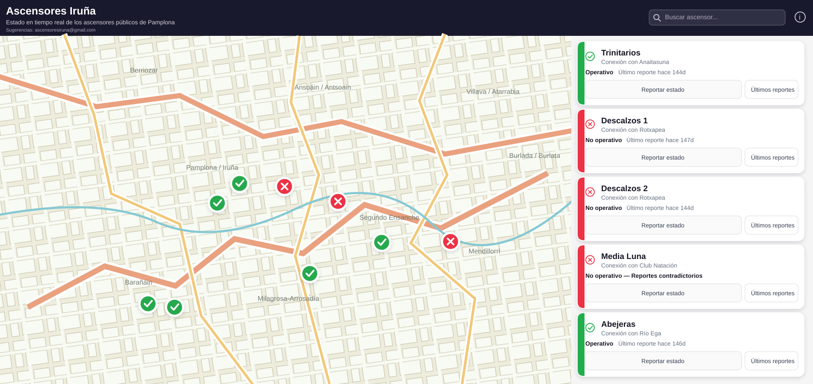

# Ascensores Iruña

Una aplicación web para consultar el estado de los ascensores públicos de Pamplona y facilitar el acceso a la información en tiempo real.

El proyecto combina una interfaz sencilla, clara y útil con una API robusta para gestionar reportes de estado y dar visibilidad a la comunidad.



## ¿Qué es?

Ascensores Iruña es una plataforma pensada para que las personas puedan:

- consultar rápidamente si un ascensor está operativo
- ver incidencias o avisos sobre su estado
- localizar ascensores en el mapa
- enviar o actualizar reportes de uso
- encontrar información útil de una forma accesible y ordenada

La aplicación está diseñada para ser cercana y funcional, sin perder un enfoque profesional y claro.

## Funcionalidades

- Mapa interactivo con la ubicación de los ascensores
- Lista de ascensores con estado visible
- Búsqueda por nombre o referencia
- Información detallada por cada ascensor
- Envío y edición de reportes de estado
- Diseño responsive para móvil y escritorio
- Backend con gestión de datos y validación

## Tecnologías

- Frontend: Angular 22
- Backend: ASP.NET Core
- Base de datos: SQLite
- Contenedorización: Docker + Docker Compose

## Estructura del proyecto

```text
ascensores-iruna/
├── Dockerfile
├── docker-compose.yaml
├── docs/
│   └── preview.svg
├── src/
│   ├── frontend/              # Aplicación Angular
│   └── backend/
│       ├── AscensoresIruna.Api/      # API ASP.NET Core
│       ├── AscensoresIruna.Api.Tests/
│       └── AscensoresIruna.Api.slnx
├── .gitignore
├── .dockerignore
└── README.md
```

## Requisitos

Antes de ejecutar el proyecto, asegúrate de tener instalado:

- Node.js 22+
- npm
- .NET 10 SDK
- Docker y Docker Compose

## Ejecutar con Docker

Desde la raíz del proyecto:

```bash
docker compose up --build
```

La aplicación quedará disponible en:

```text
http://localhost:8080
```

## Ejecutar en local

### Frontend

```bash
cd src/frontend
npm install
npm start
```

El frontend normalmente estará disponible en:

```text
http://localhost:4200
```

### Backend

```bash
cd src/backend/AscensoresIruna.Api
dotnet restore
dotnet run
```

## Variables de entorno

El proyecto usa una configuración base para desarrollo y producción, incluyendo valores como:

- `ASPNETCORE_ENVIRONMENT`
- `ASPNETCORE_URLS`
- `HMAC_SECRET`
- `ConnectionStrings__DefaultConnection`

## Desarrollo

La aplicación está pensada para seguir creciendo con una estructura simple y mantenible:

- frontend para la experiencia de usuario
- backend para la lógica y gestión de datos
- SQLite para facilitar despliegues locales y pruebas rápidas

## Contribución

Las contribuciones son bienvenidas. Si quieres mejorar la aplicación:

1. Haz un fork del repositorio
2. Crea una rama para tu cambio
3. Realiza la modificación
4. Abre un pull request con una descripción clara
